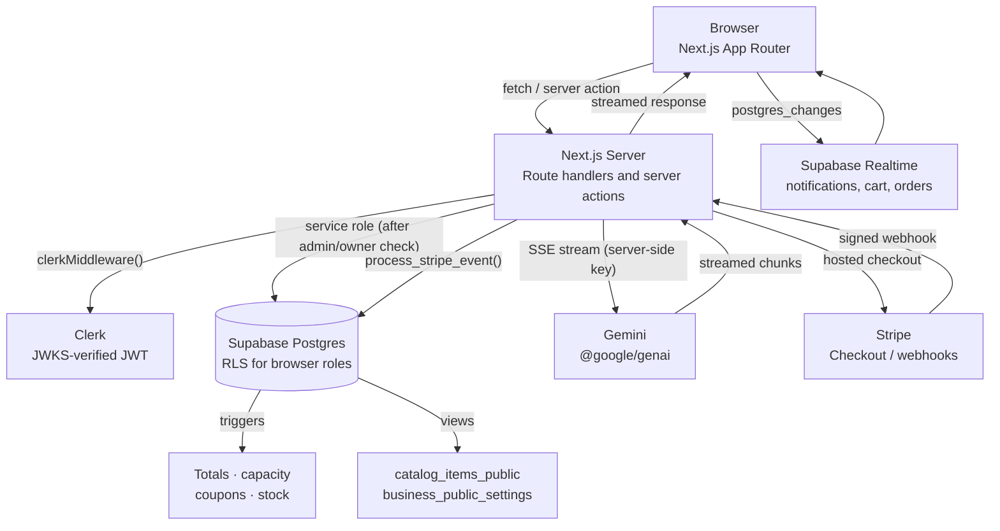

<div align="center">

# ☕ Cafe

**A full-stack cafe platform with a streaming AI concierge, database-priced checkout, and role-scoped operations.**

[](https://cafe-ruddy-pi.vercel.app)
[](https://YOUR_VIDEO_URL)
[](./LICENSE)

[](https://nextjs.org)
[](https://www.typescriptlang.org)
[](https://supabase.com)
[](https://clerk.com)
[](https://stripe.com)
[](https://ai.google.dev)

<!-- TODO: replace with a hero screenshot or a 10-second GIF of the AI concierge adding an item to the cart -->


[**Live demo**](https://cafe-ruddy-pi.vercel.app) · [**Walkthrough**](https://YOUR_VIDEO_URL) · [**Architecture**](#architecture) · [**Quick start**](#quick-start)

</div>

---

## Overview

|  |  |
| :--- | :--- |
| **What** | A cafe platform where customers order, book and pay in one flow, and admins run orders, bookings, inventory, branches and analytics from a live dashboard. |
| **Why it's interesting** | Prices, discounts, totals, capacity and booking windows are computed by Postgres triggers. The client sends only item IDs and quantities. A Gemini-powered concierge turns natural language into typed, validated, confirm-gated actions. |
| **Stack** | Next.js (App Router, Server Actions) · TypeScript (strict) · Supabase (Postgres, RLS, Realtime, Storage) · Clerk · Stripe · Gemini · Zod · Vitest |

## Contents

- [Demo](#demo)
- [Highlights](#highlights)
- [Architecture](#architecture)
- [Core guarantees](#core-guarantees)
- [Design decisions](#design-decisions)
- [Feature deep dives](#feature-deep-dives)
- [Data model](#data-model)
- [Quick start](#quick-start)
- [Environment variables](#environment-variables)
- [Scripts](#scripts)
- [Project structure](#project-structure)
- [Testing](#testing)
- [Deployment](#deployment)
- [Operations](#operations)
- [Security model](#security-model)
- [Troubleshooting](#troubleshooting)
- [Known limitations](#known-limitations)
- [Roadmap](#roadmap)
- [Contributing](#contributing)
- [License](#license)

---

## Demo

|  |  |
| :--- | :--- |
| **Live app** | [cafe-ruddy-pi.vercel.app](https://cafe-ruddy-pi.vercel.app) |
| **Walkthrough video** | [YOUR_VIDEO_URL](https://YOUR_VIDEO_URL) |
| **Admin demo access** | _Add demo credentials here, or remove this row._ |

<!-- TODO: replace with a thumbnail of your video. The link below should point to your video. -->
[](https://YOUR_VIDEO_URL)

<!-- TODO: add real screenshots to docs/assets/ and keep the filenames, or update the paths. -->

| Storefront | AI concierge |
| :---: | :---: |
|  |  |
| **Checkout** | **Customer dashboard** |
|  |  |
| **Admin: Orders** | **Admin: Analytics** |
|  |  |

---

## Highlights

- **AI concierge with typed actions.** Gemini streams responses, and each reply can carry at most one action (`ADD_TO_CART`, `PREFILL_RESERVATION`, `UPDATE_ORDER_STATUS`, …). The client validates it, routes it, and asks for confirmation on destructive ones. One chat engine serves customers (30 actions) and admins (12 actions) with different tools, prompts and rate limits.
- **Admin control center.** Six modules (Orders, Reservations, Inventory, Branches, Analytics, Coupons) with realtime sync, optimistic mutations and confirmation gates for destructive writes.
- **Customer dashboard.** Orders with a live status timeline, capacity-aware booking cancellation, favorites, coupons (admin-defined and game rewards), and a notification center with per-type mute and Web Push.
- **Database-enforced pricing and bookings.** Prices, discounts, totals, capacity and booking windows are computed by Postgres triggers. The server never trusts a number the browser typed.
- **Server-side authorization.** Route protection lives in server layouts (`app/settings`, `app/customer`, `app/admin`). RLS is the second boundary: mutating policies re-check the caller's role in the database.
- **Stripe checkout with a ledger.** `order_payments` records sessions, payment intents, refunds and disputes. Late payments, amount mismatches and failed refunds are flagged rather than silently accepted.
- **Idempotent by design.** `process_stripe_event()` deduplicates events, `claim_game_reward()` is race-safe, and checkout rolls back cleanly when a coupon expires mid-flight.
- **End-to-end validation.** Zod schemas validate every AI action and server action input, and the action schema is asserted at compile time to match the `ActionPayload` union.
- **Accessibility.** Interactive components have a named control, a visible focus ring, and a `prefers-reduced-motion` path.
- **Operational checks in SQL.** `assert_production_ready()`, `ops_health()` and `api_surface_violations()` verify RLS, cron jobs, Stripe reconciliation and API drift.

| Area | What it does |
| :--- | :--- |
| **Storefront** | Menu grid with filters, favorites, live catalog, product modal with reviews |
| **Cart and checkout** | Server-priced totals, coupons, Stripe-hosted payment, in-person payment option |
| **Bookings** | Location-aware slot prefill, capacity-enforced inserts, cancellation |
| **Customer dashboard** | Orders, bookings, favorites, coupons, ratings |
| **Admin dashboard** | Orders, reservations, inventory, branches, analytics, coupons, rewards |
| **Notifications** | In-app inbox, per-type mute, Web Push, delivery log |
| **Auth** | Clerk for identity; Supabase RLS keyed on the Clerk JWT |
| **Payments** | Stripe Checkout plus a reconciled `order_payments` ledger |

---

## Architecture

Three surfaces share one design system, one data layer and one AI engine.

```text
                  ┌──────────────────────────────────────┐
                  │          Shared foundation           │
                  │  Next.js · Clerk · Supabase · Stripe │
                  │  RLS · triggers · typed actions      │
                  └──────────────────┬───────────────────┘
                                     │
          ┌──────────────────────────┼──────────────────────────┐
          ▼                          ▼                          ▼
   ┌─────────────┐           ┌───────────────┐          ┌───────────────┐
   │ Storefront  │           │   Customer    │          │     Admin     │
   │  (public)   │           │   dashboard   │          │   dashboard   │
   │             │           │  (/customer)  │          │   (/admin)    │
   └──────┬──────┘           └───────┬───────┘          └───────┬───────┘
          └──────────────────────────┼──────────────────────────┘
                                     ▼
                          ┌─────────────────────┐
                          │    AI concierge     │
                          │ customer + admin    │
                          └─────────────────────┘
```



<details>
<summary>Plain-text version of the diagram</summary>

```text
Browser (Next.js App Router)
  |  fetch / server action                 ^  streamed response
  v                                        |
Next.js Server ──────────────────────────────┘
  |-- clerkMiddleware() ----> Clerk (JWKS-verified JWT)
  |-- service role client --> Supabase Postgres (triggers, views; RLS for browser roles)
  |-- server-side key ------> Gemini (SSE stream)
  |-- hosted checkout ------> Stripe Checkout
                                  |  signed webhook
                                  v
                          process_stripe_event() --> Postgres

Supabase Realtime ── postgres_changes ──> Browser
```

</details>

### Design principles

1. **The database is the source of truth for money.** Order totals are written as `0` and computed by `validate_order_integrity()`. The client never prices a line.
2. **Auth is a pre-check; RLS is the boundary for browser roles.** Layouts redirect early for good UX, and every policy re-verifies the caller.
3. **Actions are typed, not parsed from prose.** The model emits at most one JSON action per reply, and Zod validates it before the client trusts it.
4. **Service-role writes sit behind an admin or owner check.** Browser clients get direct table access only where RLS is sufficient.
5. **Fail closed.** Unknown Stripe events are acknowledged and ignored, unknown action types are no-ops, and a missing row on delete counts as success.

## Core guarantees

| Guarantee | Mechanism |
| :--- | :--- |
| Totals can't be forged | `validate_order_integrity()` re-prices from `catalog_items` on insert and update |
| Discounts can't be double-spent | `reserve_coupon_for_order_internal()` locks the coupon row before incrementing `used_count` |
| Capacity can't be exceeded | `location_peak_occupancy()` computes peak usage and is enforced on booking insert and update |
| Past bookings are rejected | `set_booking_timestamp()` rejects past timestamps and re-reads the location timezone |
| Stripe events apply once | `stripe_events.id` is a primary key; `apply_stripe_event()` is idempotent per event |
| Refunds reconcile | `order_payments` tracks `amount_refunded`, `refund_due`, and failed refund IDs |
| Admin actions require admin | Every admin server action calls `assertIsAdmin()` or `resolveAdminContext()` before touching the DB |
| Concurrent confirms don't overwrite | `eq("status", currentStatus)` compare-and-swap in `updateBookingStatus()` |
| The AI can't invent a record | Actions carry IDs resolved from the live snapshot; unknown IDs surface as a toast |
| Signed-out users aren't dead-ended | `SIGNED_IN_ONLY_ACTIONS` routes through `REQUIRE_SIGNIN` before any gated flow |

## Design decisions

| Decision | Why | Trade-off |
| :--- | :--- | :--- |
| **Totals computed in Postgres triggers, not app code** | One enforcement point that every client, script and future service must pass through | Business logic lives in SQL, so it needs its own tests |
| **Authorization from `profiles.role`, not Clerk metadata** | The row is written only by a verified webhook under `service_role`, and RLS can read it directly | Role changes depend on the Clerk webhook being healthy |
| **Realtime as a signal, then refetch** | Works where browser roles hold no `SELECT` on the base table; payloads never leak columns | One extra round trip per change, softened by a 250 ms debounce |
| **One typed action per AI reply** | Easy to validate, confirm and audit; no free-form tool loops | Multi-step requests rely on slot-filling and follow-up turns |
| **Browser uploads to Storage, server writes the row** | No byte proxying; bucket-level RLS is enough for files, and Zod plus `revalidatePath()` still guard the row | Two-step flow; an orphaned file is possible if the row write fails |
| **Compare-and-swap on status updates** | Detects concurrent admin edits without locks or version columns | A losing writer must refresh and retry |
| **Single idempotent `sql.sql` install** | A fresh project reproduces the full schema in one transaction and ends by asserting readiness | A large file; migrating existing production data needs separate handling |

---

## Feature deep dives

<details>
<summary><strong>🤖 The AI concierge</strong></summary>

<!-- TODO: add a GIF of an action card being confirmed -->


Two surfaces share one streaming client but use different tools.

| Surface | Route | Who can call it | Actions |
| :--- | :--- | :--- | :--- |
| **Customer** | `POST /api/ai/chat` | Anyone (rate-limited per user or IP) | 30: cart, reservations, coupons, navigation, notifications, theming |
| **Admin** | `POST /api/ai/admin-chat` | Signed-in admins only (`403` otherwise) | 12: status toggles, order and reservation updates, rewards, analytics queries |

**How a turn works**

1. `ChatWidget` sends the trimmed history plus a `chatId` (signed-in users only) and an `x-cafe-request-id` header.
2. The route enforces rate limits, loads live context (catalog, locations, coupons, and for admins today / 7-day / 30-day order aggregates), and streams from Gemini. The API key never leaves the server.
3. Each chunk passes through `parseActionPayload()`. Any `[ACTION_DATA:{…}]` marker is extracted, validated against `ActionPayloadSchema`, and streamed to the client as a structured action.
4. The client strips the marker from the visible text and renders a "Proceed" card. Destructive actions open a confirmation dialog first.
5. **Slot-filling:** if an action needs more fields (for example a reservation date), the pending state is stored, the next user reply is consumed locally, and the action dispatches only when complete.
6. If the request is signed in and the chat belongs to that user, the assistant message is persisted server-side. Browser clients can only write `role = 'user'`.

**Customer actions (30)**

`NAVIGATE_SECTION` · `FILTER_MENU` · `OPEN_DIRECTIONS` · `OPEN_CONTACT` · `REQUIRE_SIGNIN` · `PREFILL_RESERVATION` · `CANCEL_BOOKING` · `VIEW_RESERVATIONS` · `ADD_TO_CART` · `REMOVE_FROM_CART` · `UPDATE_CART_ITEM` · `CLEAR_CART` · `START_CHECKOUT` · `APPLY_COUPON` · `VIEW_ORDERS` · `RATE_ORDER` · `VIEW_FAVORITES` · `ADD_TO_FAVORITES` · `REMOVE_FROM_FAVORITES` · `VIEW_COUPONS` · `OPEN_REWARD` · `OPEN_NOTIFICATIONS` · `MUTE_ALL_NOTIFICATIONS` · `UNMUTE_ALL_NOTIFICATIONS` · `MUTE_NOTIFICATION_TYPE` · `UNMUTE_NOTIFICATION_TYPE` · `ENABLE_PUSH` · `DISABLE_PUSH` · `SET_THEME_MODE` · `SET_COLOR_PALETTE`

**Admin actions (12)**

`NAVIGATE_ADMIN` · `VIEW_REVENUE` · `VIEW_ORDER_STATS` · `VIEW_TOP_ITEMS` · `TOGGLE_ITEM_ACTIVE` · `TOGGLE_ITEM_POPULAR` · `UPDATE_ORDER_STATUS` · `TOGGLE_ORDER_PAID` · `UPDATE_RESERVATION_STATUS` · `TOGGLE_BRANCH_ACTIVE` · `TOGGLE_COUPON_ACTIVE` · `UPDATE_GAME_REWARD`

**Safety rails**

- **Destructive actions are confirm-gated.** Actions listed in `DESTRUCTIVE_ACTIONS` (`UPDATE_ORDER_STATUS`, `TOGGLE_ITEM_ACTIVE`, `CLEAR_CART`, …) cannot run unless `dispatchChatAction` has a `requestConfirmation` handler.
- **The AI cannot invent records.** Actions carry IDs resolved from the live snapshot. Unknown IDs surface as a toast, never as a write.
- **Signed-out users are not dead-ended.** `SIGNED_IN_ONLY_ACTIONS` routes through `REQUIRE_SIGNIN` before any gated flow.
- **Actions route to the live tab.** For example `TOGGLE_ITEM_ACTIVE` dispatches `ADMIN_TOGGLE_ITEM_ACTIVE`, the admin page navigates to `/admin?tab=inventory`, and `useAiInventoryActions` finds the target by ID after a short settle delay and calls the same `toggleActive` handler the manual button uses.
- **Rate limiting** uses shared `AI_RATE_LIMIT_WINDOW_MS` / `AI_RATE_LIMIT_MAX_REQUESTS` constants, consumed by both the server window and the client pre-flight check. A `429` shows a countdown; a `503` shows a short retry hint.

</details>

<details>
<summary><strong>🛠️ Admin dashboard</strong></summary>

<!-- TODO: add an admin overview screenshot -->


A six-module control center behind a server-side role gate. Each module is a self-contained tab that mounts only when active, subscribes to its own realtime channel, and mutates the database through validated server actions.

**Entry gate:** `app/admin/layout.tsx`

```ts
const { userId } = await auth();
if (!userId) redirect("/sign-in?redirect_url=%2Fadmin");

const access = await getAdminAccess(userId);
if (access.status === "error") {
  console.error("[admin/layout] profile lookup failed - failing closed", access);
  redirect("/customer");
}
if (access.status !== "admin") redirect("/customer");
```

The gate is server-side, so a non-admin never sees admin chrome. Authorization uses `public.profiles.role = 'admin'`, not Clerk metadata. The profile row is written only by the Clerk webhook under `service_role`, so it cannot be forged from the client. Non-admins and lookup failures land on `/customer` (fail closed).

| Module | Path | What it does |
| :--- | :--- | :--- |
| **Orders** | `app/admin/components/OrdersTab` | Active / Scheduled / Past views, in-row status menu, mark-paid button, item-name resolution, realtime refetch |
| **Reservations** | `app/admin/components/AdminReservationsTab` | Pending / confirmed / completed / cancelled state machine with confirm, reject and complete buttons |
| **Inventory** | `app/admin/components/CatalogInventoryTab` | Create, edit, delete items; drag-to-reorder gallery; image upload to Supabase Storage; realtime product sync |
| **Branches** | `app/admin/components/Locationstab` | Create, edit, reorder, deactivate, delete locations; timezone validation; image upload |
| **Analytics** | `app/admin/components/AnalyticsTab` | Revenue trajectory, order count, top and least item, logistics split, time-range selector |
| **Coupons** | `app/admin/components/CouponsTab` | Create, edit, enable, disable coupons; configure the live game reward |

**Orders**

```ts
type OrderView = "active" | "advanced" | "past";
```

- **Active:** `incoming`, `pending`, `approved`, `preparing`, `ready`, and not scheduled.
- **Scheduled:** `order_type = 'scheduled'` and not yet completed or declined.
- **Past:** `completed`, `declined`, `refunded`.

Each card renders an order identity (icon, short ID, paid badge, customer name), a progress bar with the four fulfilment steps, a status menu with valid transitions, and a mark-paid button for unpaid in-person orders only. Status changes and payment toggles go through `useOrderActions`, which calls the server action (`updateOrderStatus` / `toggleOrderPayment`), parses the `{ success: false, error }` result, and surfaces a toast. It never throws on network errors.

A `postgres_changes` subscription on `orders` refetches after a 250 ms debounce, so a change from another admin lands within about a second.

**Reservations**

```text
pending ──► confirmed ──► completed
   │            │
   └──► cancelled ◄──┘
```

`ALLOWED_TRANSITIONS` in `constants.ts` is the single source of truth. The UI derives its buttons from it and the server action rejects anything outside it. Updates use compare-and-swap:

```ts
.update({ status: nextStatus })
.eq("id", id)
.eq("status", currentStatus)   // the CAS
.select("id");
```

If another admin already moved the booking, the update matches zero rows and the hook reports "already updated elsewhere, refreshing…" instead of silently overwriting.

**Inventory**

The form is uncontrolled and read from `FormData` on submit, because a React form action would reset the fields before the server validates them. Images upload from the browser to the `catalog-media` bucket, where storage RLS (`catalog_media_admin_insert`) enforces `is_admin_v2()`. The catalog row write goes through `catalogActions.ts` so Zod validation and `revalidatePath()` run server-side.

Realtime is a signal, not a payload. Browser roles hold no `SELECT` on `catalog_items` (migration 0023), so change events only trigger a refetch from `admin_catalog_items`, the admin-gated view.

**Branches**

| Action | Server action | Guard |
| :--- | :--- | :--- |
| Create / update | `saveLocation` | Zod schema + `withAdmin()` |
| Reorder | `moveLocation` | Atomic swap RPC |
| Activate / deactivate | `setActive` | `withAdmin()` |
| Delete | `removeLocation` | FK protection surfaces a friendly message |

Reordering is one RPC, not two updates. Rows are locked in ID order, so concurrent swaps cannot deadlock:

```sql
create or replace function public.swap_location_display_order(
  p_location_id_a uuid, p_location_id_b uuid
) ...
  perform 1 from public.business_locations where id = v_first for update;
  perform 1 from public.business_locations where id = v_second for update;
  update public.business_locations
  set display_order = case id when p_location_id_a then v_b else v_a end
  where id in (p_location_id_a, p_location_id_b);
```

**Analytics**

Read-only, computed client-side from the loaded orders and selected range by `computeFilteredAnalytics()`: gross revenue, total volume, hot item and cold item, plus an area chart over time and a donut of `order_type × payment_method`. Currency comes from `business_settings.currency` via `useBusinessCurrency`, so every figure matches the customer-facing price.

**Coupons**

- **Standard coupons:** create, edit, enable, disable. Soft-delete means disable (there is no `deleted_at` column). Every field is validated by `validateCouponInput()` before the server action runs.
- **Game reward:** the single row that drives the storefront scratch card (title, promo code, discount tag, description, active flag). Changes affect future claims only; customers who already won keep the terms they were shown.

**Admin AI assistant**

The same `ChatWidget` serves the admin surface, with three differences: `/api/ai/admin-chat` calls `getVerifiedAdmin()` and returns `403` to anyone else; the prompt includes fresh order aggregates, recent orders, pending bookings, locations, catalog and coupons on every request; and only admin actions are available.

</details>

<details>
<summary><strong>👤 Customer dashboard</strong></summary>

<!-- TODO: add a customer dashboard screenshot -->


A four-tab personal console behind a server-side auth gate at `/customer` (`app/customer/layout.tsx`). It uses a slide-in sidebar on mobile and a fixed rail on desktop. A single realtime channel (`useDashboardRealtime`) subscribes to `orders`, `favorites` and `bookings`, filtered by `user_id`, so changes from another tab land within about a second.

| Tab | Data source | Badge |
| :--- | :--- | :--- |
| **Orders** | `orders` filtered by `user_id` | Count of `incoming` / `pending` / `approved` / `preparing` / `ready` |
| **Bookings** | `bookings` filtered by `user_id` | Count of `pending` / `confirmed` |
| **Favorites** | `favorites` joined to `catalog_items` | Favorites count |
| **Coupons** | `coupons` + `user_claimed_rewards` | n/a |

**Orders.** Active, Scheduled and Past views mirror the admin tab. Each order shows a status badge, a four-step progress bar (skipped for terminal states), a currency-formatted total with a **Rate** button for completed orders, and item chips with live names resolved from `catalog_items_public` in one query. `RateOrderModal` filters out items already reviewed (unique on `user_id, order_id, catalog_item_id`) and submits one row per item in a single insert. The deep link `?rateOrder=<id>` (from the AI's `RATE_ORDER` action and the `review_prompt` notification) is honored only if the order is in the loaded list; stale IDs close the modal instead of opening a bad one.

**Bookings.** A three-step progress bar (`pending → confirmed → completed`) with a cancel button on `pending` and `confirmed` bookings only. Manual and AI-driven cancellation converge on one `performCancel`, which checks the current status from a ref rather than a stale snapshot, refreshes through the parent so realtime-disabled deployments still settle, and shows a banner on failure that auto-dismisses after 5 s.

**Favorites.** A grid with per-item remove. `useRemoveFavorite` tracks an in-flight set per ID so a double-click cannot fire two deletes, and always clears the spinner in `finally`.

**Coupons.** Available coupons (admin-defined plus claimed game rewards) have a Copy Code button; expired and used ones are dimmed. `mergeCoupons()` dedupes by code, so a claimed `WELCOME10` does not appear twice.

**Notifications.** The notification center lives in the global header.

- **In-app inbox** from `notifications`, capped at 10 items.
- **Per-type mute** via `notification_settings.muted_types`, which gates toasts and sounds.
- **Web Push** through `push_subscriptions`, claimed with the serializable `claim_push_subscription` RPC.
- **Delivery log** in `push_delivery_log`, so failures can be audited.

Clicking a notification routes to the right place: `review_prompt` opens the Rate modal, `order_status` opens Orders, and `reservation_status` opens Bookings.

</details>

---

## Data model

A trimmed view of the tables that carry the most semantics.

```text
profiles ─┐
          ├── orders ── order_payments ── stripe_events
          │         └── coupon_redemptions
          ├── bookings ── business_locations ── resources
          │                         └── location_opening_hours, location_closures
          ├── favorites, cart_items, reviews
          ├── notifications, notification_settings, push_subscriptions
          ├── chats ── chat_messages
          └── user_claimed_rewards ── game_rewards
catalog_items ── reviews (1:N)
coupons ── coupon_redemptions
```

Views exposed to the browser:

- `catalog_items_public`: active items, derived `in_stock`, no Stripe IDs.
- `business_public_settings`: currency, business name, party-size cap.
- `game_rewards_public`: active rewards without the promo code.
- `admin_catalog_items`: full catalog, gated by `is_admin_v2()`.

## Tech stack

| Layer | Choice |
| :--- | :--- |
| Framework | Next.js 15+ (App Router, Server Actions, RSC) |
| UI | React 19, Tailwind CSS v4, Framer Motion, Lucide |
| Language | TypeScript (strict) |
| Database | Supabase (Postgres 15+, RLS, Realtime, Storage) |
| Auth | Clerk (JWKS-verified JWTs, server-side `auth()`) |
| Payments | Stripe Checkout, signed webhooks |
| AI | Google Gemini via `@google/genai` (streaming) |
| Validation | Zod (`.strict()` on action schemas) |
| Testing | Vitest |
| Hosting | Vercel (app) + Supabase (data) |

---

## Quick start

**Prerequisites:** Node.js 20.19+, npm, a Supabase project (free tier is fine), a Clerk application, and a Stripe test account for payments.

```bash
git clone https://github.com/shaurya-10000/cafe.git
cd cafe
npm install
cp .env.example .env.local
```

1. Fill in `.env.local` (see [Environment variables](#environment-variables)).
2. Apply the schema: paste `sql.sql` into the Supabase SQL editor and run it.
3. Start the app:

   ```bash
   npm run dev
   ```

4. Sign in once, then promote yourself to admin with your Clerk user ID:

   ```sql
   update public.profiles set role = 'admin' where id = '<your-clerk-user-id>';
   ```

Open [http://localhost:3000](http://localhost:3000).

> [!NOTE]
> `sql.sql` is a single, idempotent, transaction-wrapped install. It creates the schema, seeds the catalog, and ends by running `assert_production_ready()`. If any invariant fails, the whole transaction rolls back.

## Environment variables

| Variable | Scope | Required | Purpose |
| :--- | :--- | :---: | :--- |
| `NEXT_PUBLIC_SUPABASE_URL` | Public | ✅ | Supabase project URL |
| `NEXT_PUBLIC_SUPABASE_ANON_KEY` | Public | ✅ | Anon key (RLS-enforced) |
| `SUPABASE_SERVICE_ROLE_KEY` | Server | ✅ | Service role for admin writes and webhooks |
| `NEXT_PUBLIC_CLERK_PUBLISHABLE_KEY` | Public | ✅ | Clerk publishable key |
| `CLERK_SECRET_KEY` | Server | ✅ | Clerk secret key |
| `CLERK_WEBHOOK_SIGNING_SECRET` | Server | ✅ | Clerk webhook verification |
| `STRIPE_SECRET_KEY` | Server | ✅ | Stripe API key |
| `STRIPE_WEBHOOK_SECRET` | Server | ✅ | Stripe webhook signing secret |
| `GEMINI_API_KEY` | Server | ⚠️ | Enables the AI concierge; unset returns `503` |
| `NEXT_PUBLIC_VAPID_PUBLIC_KEY` | Public | ⚠️ | Web Push |
| `VAPID_PRIVATE_KEY` | Server | ⚠️ | Web Push |
| `VAPID_SUBJECT` | Server | ⚠️ | Web Push (for example `mailto:you@example.com`) |
| `PUSH_WEBHOOK_SECRET` | Server | ⚠️ | Database webhook auth |
| `NEXT_PUBLIC_SITE_URL` | Public | ⚠️ | Absolute origin for Stripe redirects |
| `AI_LOG` | Server | ➖ | `1` enables structured AI request logging |
| `AI_LOG_IP_SALT` | Server | ➖ | Salt for guest IP hashing |

✅ required everywhere · ⚠️ required for that feature · ➖ optional

## Scripts

| Command | Purpose |
| :--- | :--- |
| `npm run dev` | Development server |
| `npm run build` | Production build |
| `npm run start` | Serve the production build |
| `npm run lint` | ESLint |
| `npm run typecheck` | Strict type check (`tsc --noEmit`) |
| `npm test` | Vitest (watch) |
| `npm run test:run` | Vitest (CI) |

Pre-flight before any PR or deploy:

```bash
npm run typecheck && npm run lint && npm run test:run && npm run build
```

## Project structure

```text
.
├── app/
│   ├── layout.tsx                    # Root layout: palette anti-flash, fonts, providers
│   ├── page.tsx                      # Storefront: hero, menu, locations, booking, rewards
│   ├── admin/
│   │   ├── layout.tsx                # Server-side admin gate
│   │   ├── actions.ts                # Server actions: checkout, orders, payments
│   │   ├── actions/                  # Domain actions: catalog, coupons, locations, reservations
│   │   └── components/               # Admin tabs: orders, reservations, inventory, …
│   ├── customer/                     # Customer dashboard (orders, bookings, favorites, coupons)
│   ├── settings/                     # Profile, appearance, security
│   ├── sign-in/, sign-up/            # Clerk-hosted auth
│   ├── success/                      # Order confirmation, polls `get_order_status`
│   └── api/
│       ├── ai/chat/route.ts          # Customer AI (streaming, rate-limited)
│       ├── ai/admin-chat/route.ts    # Admin AI (admin-only, streaming)
│       ├── ai/title/route.ts         # Chat title generation
│       └── webhooks/                 # Stripe, Clerk, push
├── components/
│   ├── Hero/, CatalogGrid/, …
│   ├── ai/                           # ChatWidget and its hooks
│   ├── OrderSidebar/                 # Cart, checkout, coupon input
│   ├── BookingsSection/              # Reservation form with prefill
│   └── NotificationsSidebar/         # Inbox, preferences, push
├── lib/
│   ├── ai/                           # Action types, Zod schemas, slot-filling, rate limit
│   ├── server/                       # Service-role helpers, admin guards, Stripe
│   ├── coupons/, locations/, catalog/
│   └── utils/                        # cn, format, ids
├── utils/
│   ├── supabase/{client,server}.ts   # Clerk-bound Supabase clients
│   └── providers/                    # AppContext, ThemeProvider
├── types/                            # Shared client-side types
├── docs/assets/                      # README screenshots, GIFs, video thumbnail
├── sql.sql                           # Single-file, idempotent schema + seed
└── proxy.ts                          # Clerk middleware, security headers, CSP
```

> `proxy.ts` is the Next.js file convention for request-time middleware (the successor name to `middleware.ts`).

## Testing

The suite targets the areas that are expensive to get wrong: pricing, coupons, capacity, checkout, Stripe reconciliation, AI action validation and notification state.

```bash
npm test           # watch
npm run test:run   # once
```

Coverage focus:

- Order integrity: recompute, reject and clamp behavior in `validate_order_integrity()`
- Coupon reservation and release
- Stripe event processing: duplicate events, late payments, refund reversals
- AI action parsing: action types, malformed payloads, marker stripping
- Slot-filling: date, time and count parsing, expiry, dispatch gating
- Admin server actions rejecting non-admin callers
- Reservation compare-and-swap behavior

> [!WARNING]
> Some tests touch a real Supabase project. Use a disposable project or a separate database, never production.

## Deployment

### Vercel (app)

[](https://vercel.com/new/clone?repository-url=https%3A%2F%2Fgithub.com%2Fshaurya-10000%2Fcafe)

1. Push to GitHub, or use the button above.
2. Import the repo at [vercel.com/new](https://vercel.com/new). Root directory: repository root.
3. Add the environment variables from the table above. At minimum: Supabase, Clerk and Stripe.
4. Set `NEXT_PUBLIC_SITE_URL` to your deployed origin.
5. Deploy.

**Production URL:** [cafe-ruddy-pi.vercel.app](https://cafe-ruddy-pi.vercel.app)

### Supabase (data)

1. Create a project.
2. Run `sql.sql` in the SQL editor.
3. Enable the **pg_cron** extension.
4. After the first admin signs in, promote them (see [Quick start](#quick-start)).
5. Verify:

   ```sql
   select * from public.assert_production_ready();
   select * from public.ops_health();
   select * from public.api_surface_violations();
   ```

   All three should return all-`ok` (or empty) rows.

### Stripe

1. Add the webhook endpoint: `https://<your-domain>/api/webhooks/stripe`.
2. Subscribe to: `checkout.session.*`, `charge.refunded`, `charge.refund.updated`, `refund.updated`, `refund.failed`, `charge.dispute.*`.
3. Copy the signing secret into `STRIPE_WEBHOOK_SECRET`.

### Clerk

1. Add the webhook: `https://<your-domain>/api/webhooks/clerk`.
2. Subscribe to `user.created`, `user.updated` and `user.deleted`.
3. Copy the signing secret into `CLERK_WEBHOOK_SIGNING_SECRET`.

## Operations

| Concern | How it's handled |
| :--- | :--- |
| **Health** | `select * from public.ops_health()`: cron jobs, refund backlog, stale orders, push failure rate, Stripe failures |
| **Production readiness** | `select * from public.assert_production_ready()`: RLS, Stripe chain, API drift |
| **API surface drift** | `select * from public.api_surface_violations()`: any new table or function that gained browser privileges without review |
| **Stripe triage** | `select * from public.admin_stripe_events('failed', 50)`: recent failures with detail |
| **Refund backlog** | `select * from public.refunds_due(5)`: payments awaiting a refund |
| **Reconciliation** | `select * from public.replay_deferred_stripe_refunds()`: replays refund events whose payment wasn't recorded yet |
| **Retention** | `cleanup_operational_data()` (pg_cron, nightly) trims notifications, logs, attempts and audit rows |
| **Backups** | Enable Supabase daily backups; the schema is idempotent, so a restore plus `sql.sql` reproduces it |

**Suggested alerts**

- `ops_health().refund_backlog > 0` for more than 30 minutes
- `stripe_events.status = 'failed'` in the last hour
- `push_delivery_log` failure rate above 10% in the last hour
- Any `api_surface_violations()` row

## Security model

- **Clerk JWT on every request.** `clerkMiddleware()` establishes the session and `auth()` gives server components the `userId`.
- **RLS as the boundary for browser roles.** Mutating policies (`orders_admin_update`, `bookings_update_own_or_admin`, `catalog_admin_write`, …) re-check `is_admin_v2()` or `requesting_user_id()`.
- **Service role only after authorization.** `assertIsAdmin()` and `resolveAdminContext()` gate every admin server action before the service-role client is used.
- **Mass-assignment defense.** Zod `.strict()` on action schemas, with validation before any DB access.
- **BOLA-safe responses.** An unauthorized read of another user's order returns `not found`, not `forbidden`.
- **Stripe signature verification.** `stripe.webhooks.constructEvent()` rejects any payload not signed with `STRIPE_WEBHOOK_SECRET`.
- **Constant-time webhook comparison.** The push webhook compares a SHA-256 digest with `timingSafeEqual`.
- **RPC lockdown.** `revoke all` on internal helpers; only intended entry points are granted to `anon`, `authenticated` or `service_role`.
- **CSP and security headers.** Set in `proxy.ts`: strict `frame-ancestors`, `Permissions-Policy`, `COOP`, HSTS, and a Clerk-merged `Content-Security-Policy`.
- **Secret hygiene.** No secret reaches the browser. The publishable key is the only Clerk value in the bundle.

To report a vulnerability, open a **private** security advisory on the [repository](https://github.com/shaurya-10000/cafe/security/advisories). Please do not open a public issue.

## Troubleshooting

| Symptom | Cause | Fix |
| :--- | :--- | :--- |
| `Missing NEXT_PUBLIC_SUPABASE_URL` at boot | Env not loaded | Check `.env.local` and restart `npm run dev` |
| AI replies with `503` | `GEMINI_API_KEY` unset | Set the key and restart |
| Checkout returns `23514` | Coupon expired between cart and checkout | Remove the coupon and retry |
| Online order never marks paid | Stripe webhook not configured | Check the endpoint URL and signing secret |
| Booking rejected with "capacity exceeded" | Concurrent bookings filled the slot | Choose another time |
| `realtime: no Clerk token available` | Client not signed in when the subscription started | Sign in first; the channel retries on focus |
| Stripe redirect lands on `localhost` | `NEXT_PUBLIC_SITE_URL` unset in production | Set it to your deployed origin |
| `permission denied for table catalog_items` | Browser is querying the base table | Query `catalog_items_public` instead |
| Signed in but `/admin` sends you to `/customer` | Profile row missing or role isn't `'admin'` | Run `update public.profiles set role = 'admin' …` |
| Reservation confirm says "already updated elsewhere" | Another admin moved it first | Refresh and retry |

## Known limitations

- **Single business per deployment.** Multiple locations are supported, but there is no multi-tenant isolation between separate businesses.
- **Some tests need a live database.** Pricing, capacity and Stripe tests run against a real Supabase project, so they need a disposable one.
- **AI actions are single-step.** Multi-step requests rely on slot-filling and follow-up turns rather than autonomous tool loops (a deliberate safety choice).
- **Analytics are computed client-side** from loaded orders. This is fine at cafe scale but should move to SQL aggregates for large volumes.
- **Web Push is best-effort.** Delivery depends on the browser and platform, and failures are logged but not retried indefinitely.
- **English only.** Copy and AI prompts are not localized.

## Roadmap

- [ ] Move analytics aggregation to SQL views
- [ ] End-to-end tests (Playwright) for checkout and booking flows
- [ ] CI pipeline running typecheck, lint, tests and build on every PR
- [ ] Localization (i18n) for the storefront and AI concierge
- [ ] Multi-tenant mode for running several businesses on one deployment
- [ ] Order printing and kitchen display view

## Contributing

Contributions are welcome.

1. Fork the repo and create a branch: `git checkout -b feat/your-change`.
2. Make your change and add tests for any pricing, auth or payment logic.
3. Run the pre-flight check: `npm run typecheck && npm run lint && npm run test:run && npm run build`.
4. Open a pull request describing what changed and why.

Please do not commit secrets or `.env.local`.

## License

Released under the MIT license. See [LICENSE](./LICENSE).

---

<div align="center">

**Cafe** · built by [@shaurya-10000](https://github.com/shaurya-10000)

</div>